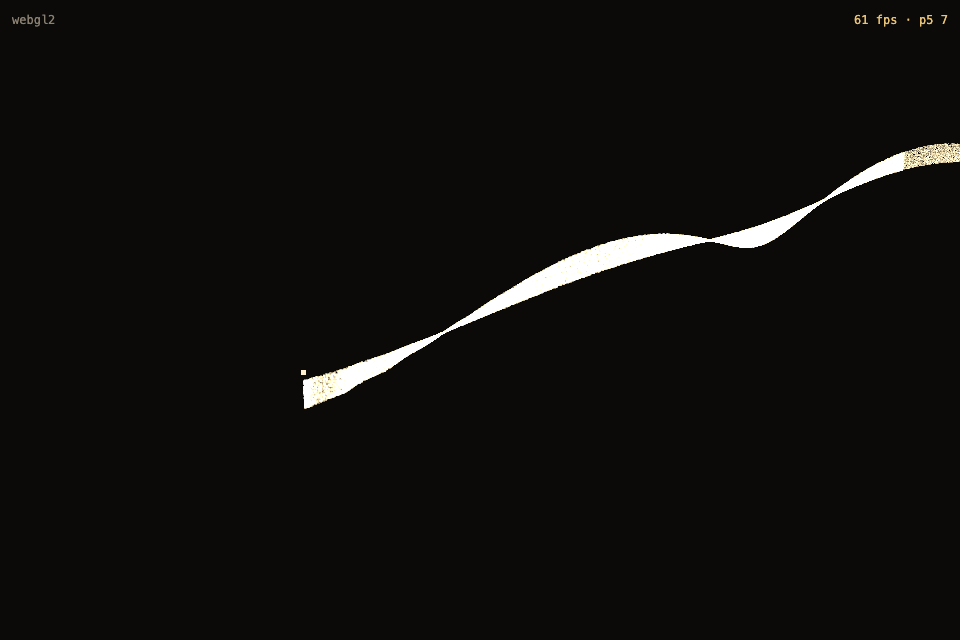
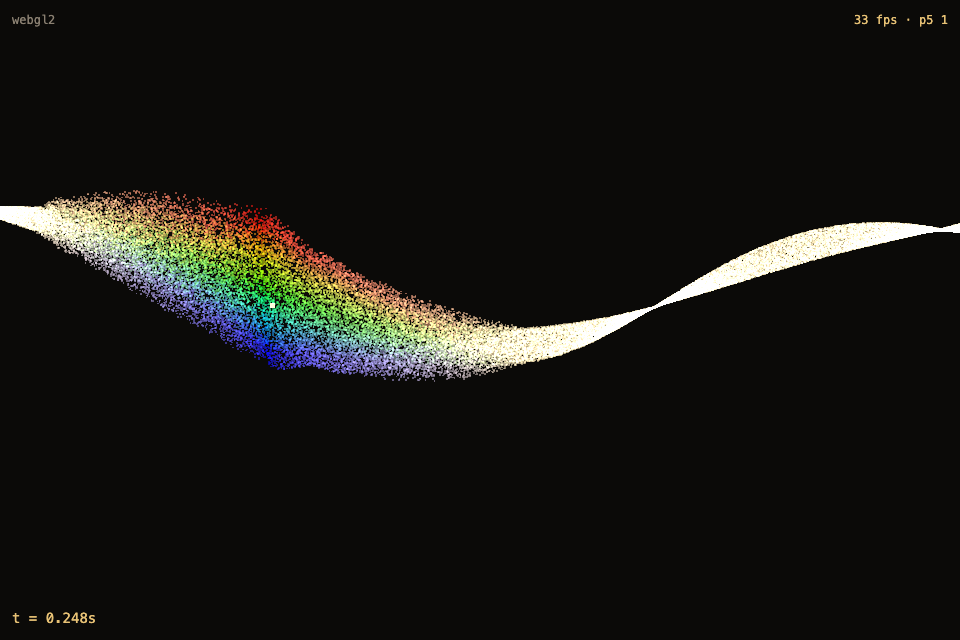
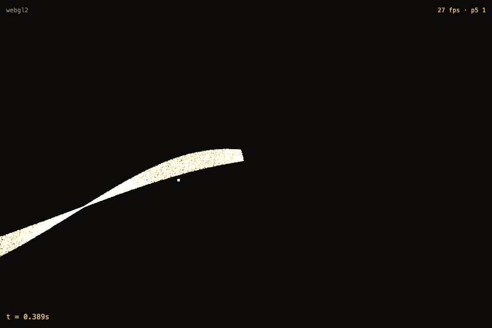

# Engine spike verdict — MERIDIAN Plan 1

**Date:** 2026-07-07
**Decision:** GATE PASSED. Engine direction confirmed: three.js r185 TSL, **webgl2-first tiers**, WebGPU behind `?webgpu` opt-in. Prism dispersion: **GO**. Proceed to Plan 2 (art direction + chapters) on this engine.

---

## 1. Gate numbers

Production preview, real Chrome, unattended playwright bench (`scripts/bench.mjs`), MacBook Air M-series, cold.

| Config | fps (avg/low) | Verdict |
|---|---|---|
| **webgl2 300k @ dpr2 (default tier)** | **60/60** | **GATE PASSED** |
| webgl2 500k | 31/26 | over budget |
| webgpu 300k | 40/35 | under webgl2 at same count |
| webgpu 500k | 28/25 | |
| webgpu 1M | 14/13 | |

**Final tiers:**

- Desktop: **webgl2 300k @ dpr2**
- Mobile: **webgl2 100k @ dpr1.5** (unmeasured, conservative)
- WebGPU tiers behind `?webgpu`: 1M / 300k

**CAVEAT (thermal):** scroll-time fps and late-session numbers are thermally contaminated — the Air heat-soaks; idle fps varied 60→32→43 with no code change. Definitive scroll-under-load fps needs a cold single-run protocol → Plan 3 QA. This is also the live argument for spec §11 adaptive quality.

## 2. Prism: GO (Vitalina, 2026-07-07)

- Spectral fan reads as optics: hue-ordered, widening + re-converging.
- Strictly window-local (pixel-probed outside the window: zero spectral leakage).
- Hero conversion (gold → currency color) persists after the window.
- Backends identical (webgl2 vs webgpu).
- **Tuning carry-forward:** fan core saturates white at high counts — saturation / window-alpha knob → Plan 3 art pass.

## 3. Root-cause log

1. **three r185 WebGPU backend: large fixed per-frame overhead on this hardware.** 50k=60fps → 100k=41fps — barely count-sensitive, i.e. the cost is per-frame, not per-particle. Consequence: webgl2-first tiers. Re-bench future three versions via `?webgpu`.
2. **React StrictMode double-mount killed the shared WebGL2 context.** The aborted engine's `WebGLBackend.dispose()` → `loseContext()` destroyed the surviving engine's shared canvas context (permanent whiteout). This invalidated all early "webgl2" benches — they were rAF on a dead canvas. Fixed via `setTimeout(0)`-deferred engine creation (see `src/App.tsx`). WebGPU was immune only because each renderer owns a separate GPUDevice.

## 4. TSL r185 drift log (for Plans 2–3)

- npm `three` ships no HTML examples — use source + `examples/jsm`.
- `THREE.TSL.ShaderNodeObject` doesn't exist → use `THREE.ComputeNode` / typed `UniformNode`.
- Particle drawable = `THREE.Sprite` + `.count` (not InstancedMesh).
- Route delivery via `uniformArray` (256 vec3 → padded vec4, 4KB UBO) works on both backends; `texture()`-in-compute was never exercised.
- `deltaTime` & `time` are renderGroup uniforms updated once per rAF BEFORE the loop callback → compute and render see identical values within a frame.
- WebGPU storage readback: vec3 padded to 16 bytes (stride 4).

## 5. Reduced-motion / zero-3D gate (this task)

`src/main.tsx` gates on `matchMedia('(prefers-reduced-motion: reduce)')` and dynamic-imports either `App` (motion) or `AppStatic` (poster shell). Verified on the production build:

- Chunk graph: three lives only in the `App-*.js` chunk (~993 KB / 287 KB gzip), reachable **only** via dynamic `import()`; entry chunk is React-only (~192 KB / 61 KB gzip), no modulepreload of the App chunk.
- Runtime (Chrome `--force-prefers-reduced-motion`, production preview): `performance.getEntriesByType('resource')` shows entry + `AppStatic-*.js` only — the three chunk is **never fetched**. Without the flag: canvas + `globalThis.__meridian` (`webgl2`, 300k) appear.
- `AppStatic.tsx` is a placeholder poster (CSS gradient); real poster art → Plan 2.

## 6. Instruments in repo

- `scripts/bench.mjs` — unattended fps matrix; run against the production preview.
- `?sweep` in-page instrument — **KNOWN BUG:** a hidden-throttled 0.2fps sample is saved past the `document.hidden` guard. Superseded by bench.mjs; fix-or-delete in Plan 3.
- Query overrides: `?count` `?dpr` `?webgl` `?webgpu` `?scale` `?alpha`.

## 7. Scroll-feel carry-forward (Task 6 review)

Slidey inertia = stacked exponential smoothers: Lenis lerp 0.1 (τ≈167ms) × engine tSmooth (τ≈270ms) ≈ 1.3s settle. Plan 3 levers, in impact order:

1. Remove one smoothing layer OR raise Lenis lerp to 0.15–0.2.
2. Consider Lenis duration+easing mode for deterministic chapter beats.
3. `wheelMultiplier`.
4. `syncTouch: true` for mobile.
5. Note: `scrollToNarrative` smoothstep compounds top/bottom slowness deliberately.

## 8. Process lesson

**Compiling ≠ working.** Every GPU change needs numeric readback + screenshot self-check — the Task 5 whiteout passed tsc, tests, and build while rendering a dead canvas.

---

## Mobile (Plan 3 Task 6 — emulation, NOT device truth)

Verified via playwright-core device emulation (isMobile + hasTouch → `matchMedia('(pointer: coarse)')` true) at 375×812, 390×844, 412×915, 768×1024. All numbers below are **indicative** — headless render on a dev laptop, DPR-capped, thermally/host-contaminated. They are NOT a real-device measurement.

### Tier that loads (emulated)
Every mobile viewport selected the **mobile tier: `webgl2` / 100 000 particles / dpr 1.5**, confirmed by reading `__meridian.tier.{backend,count}` in-page (not inferred). The crystal at 100k (compact lattice, Task 5) still reads as a cube. No WebGPU on mobile — the mobile tier is webgl2 by construction, so "both backends" is a desktop-only concern.

### What was verified (in emulation)
- **Layout / legibility.** Every chapter's kicker + headline + body + metric is clear of the river band and the settlement/paid crystal at 375 **and** 390, at the section-top snapshot **and** ~mid-runway (the sticky reading window). The binding case was peak-1's **stream reveal**, whose band sweeps up ~300px mid-runway; a static per-anchor offset that clears the snapshot did not clear the dwell, so the stream anchors carry the strongest look-bias. 412 and 768 also clean. Evidence: `scratchpad/p3t6final-{w}-{frame}.png` (matrix) + `p3t6c5*` (tuning).
- **No horizontal overflow.** `document.documentElement.scrollWidth == innerWidth` at every frame, all four widths (375/390/412/768). Copy blocks are `max-w-[480px]`, full-width with `px-6` below the `md` breakpoint; nothing exceeds the viewport.
- **Touch scroll (`syncTouch`).** Emulated touch swipes (CDP `Input.dispatchTouchEvent`) advance `window.scrollY` (0→2882px over 6 swipes), narrative `uT` (0→0.259), and the on-screen timer (`t = 0.000s` → `t = 0.114s`). Scroll is Lenis-eased, not hijacked/locked — it tracks the swipe. Evidence: `scratchpad/p3t6-touch.mjs`.
- **Pointer flow-field on touch — DECISION.** `pointermove` **does** fire for touch in Chromium (`pointerType: "touch"`); the engine's existing `pointermove` handler updated `river.uPointer` from a touch drag (`[0,0,999]→[-4.5,8.9,0]`, raycast onto the z=0 plane). So the finger perturbs the river during touch scroll as a gentle bonus. **No `touchmove` handler was added** — it would be redundant.

### The mobile fix (framing lever)
The river ribbon tracks screen center (the `lookAt` target), so on a narrow full-width-copy screen it always crossed the metric row. Camera-Y / lookAhead only slide it around the text column. Added `lookYOffset` to the camera framing (`timeline.ts` `ChapterAnchor`/`Framing`, applied in `engine.ts` before `lookAt`) — it raises the aim above the route so screen center sits above the river, sinking the whole band **uniformly** below the copy without tilt. Portrait-only in practice (landscape anchors omit it → 0). Per-anchor values in `route.ts` `PORTRAIT_OVERRIDES`. Canvas is `fixed -z-10` (behind all copy), so this was always a contrast concern (gold speckle behind the gold metric), never occlusion — the fix keeps the bright band out from behind the text.

### Indicative emulated fps
`fps · p5<5th-percentile-low>` HUD, ~6s warmup, deviceScaleFactor 2 (render dpr capped to 1.5):
- 390×844 (100k): ~57–60 fps steady; p5-low 28 (warmup dip).
- 768×1024 (100k): ~50–60 fps steady; p5-low 48.

### ⚠ MUST verify on a real device before Awwwards submission
DPR-capped fps in headless emulation is **not** device truth (spec §11 adaptive-quality argument still stands; the Plan-1 thermal caveat too). Before submission, Vitalina must open the live site on a **real phone** and confirm: (1) sustained fps under scroll on a mid-range handset (the 100k tier is conservative but unmeasured on-device); (2) touch-scroll feel (Lenis syncTouch momentum vs native); (3) legibility in daylight; (4) no thermal throttling over a full scroll-through. This is a manual step — emulation covered layout, legibility, overflow, and touch-plumbing only.

---

## Performance gate (Plan 3 Task 7 — 2026-07-10)

**Protocol caveat, up front.** Every fps number and the Lighthouse *performance* score below were captured on a MacBook Air that had been thermally soaked by days of benching **and** was under heavy concurrent load (system load average **5–15**, a full Chrome session + MCP servers running) throughout this pass. They are **THERMAL / LOAD-LIMITED**, not cold-hardware truth. The cold reference for the default tier is the Plan-1 gate: **webgl2 300k @ dpr2 = 60/60**. Before Awwwards submission, Vitalina must re-capture these on a fresh, idle machine — the cold protocol is documented in the `scripts/bench-scroll.mjs` header.

### Bundle & page-weight budgets (spec §7) — PASS

| Budget | Limit | Actual (gzip) | Verdict |
|---|---|---|---|
| Entry + App JS | ≤ 500 KB | **~350 KB** (entry 60.7 + App 289.6; +SiteHeader 3.9 = 354) | ✅ ~70% of budget |
| Total page weight (runtime) | ≤ 5 MB | **~0.4 MB** transferred / ~1.3 MB raw | ✅ far under |

Raw chunk sizes: index (entry, React-only) 192 KB, App (three/gsap/lenis) 999 KB, SiteHeader 10 KB, CSS 14.7 KB, HTML 1.9 KB. Fonts (woff2, all four) 81 KB — only the preloaded italic (16 KB) is eager. `og.png` (236 KB) is crawler-only (og:image), never fetched by the page. The three.js chunk stays behind the dynamic import, so reduced-motion visitors fetch **zero** of it (Plan-1 §5).

### Lighthouse desktop — 100 / 100 / 100 on the three deterministic categories

`npx lighthouse http://localhost:5202 --preset=desktop` → report: `docs/qa/lighthouse-desktop.report.{html,json}`.

| Category | Score | Notes |
|---|---|---|
| Accessibility | **100** | Plan-2 a11y gate holds |
| Best practices | **100** | no console errors, no deprecated APIs |
| SEO | **100** | ← **was 91**; fixed this task |
| Performance | 57 → **81** (load-variant) | see below — not a cheap-win category |

Metrics (best run): **LCP 1.0 s · CLS 0.007 · TBT 360 ms · FCP 0.6 s**. LCP (the DOM hero H1) and CLS (the `fixed` canvas never shifts) are green; the perf **score** is the only soft number and it swung **57 → 81 between two runs minutes apart on identical code** (TBT 3,890 ms → 360 ms) purely with machine load — direct evidence the score tracks the box, not the code. A perfect 100 on a continuously-running full-screen WebGL particle simulation is not a realistic target (the rAF compute+render loop is main-thread work Lighthouse books as TBT); the genuinely fixable levers (LCP / CLS / robots) are all done. Cold re-run pending on real hardware.

**SEO fix (the one real code change):** Lighthouse's `robots-txt` audit failed because the SPA returned `index.html` for `/robots.txt`. Added `public/robots.txt` (`User-agent: * / Allow: /`) → audit passes → **SEO 91 → 100**.

### Scroll-motion fps — new instrument `scripts/bench-scroll.mjs` (thermal/load-limited)

Smooth wheel-driven sweep top→bottom over 30 s (reached 95 % of page, narrative uT 0.987), sampling rAF into 1 s buckets — the moving-camera worst case (compute + camera rail + crystallization + prism/gate windows all in flight):

| Measurement (same box, same session) | avg | p5 | min1s |
|---|---|---|---|
| **Scroll motion** (`bench-scroll.mjs`) | 27 | 22 | 19 |
| **Steady-state parked** (`bench.mjs` protocol) | 16 | — | 12 |

### 60 fps verdict + adaptive-quality decision — **NOT implemented (correctly)**

Decision rule: wire adaptive quality only if the cold-ish scroll number genuinely fails **and** a `mesh.count` reduction demonstrably helps; if the failure is clearly just thermal (idle fps also low), do **not**.

**It is unambiguously thermal / load.** The steady-state **parked** number (16 fps avg) is *lower* than the scroll number (27 fps avg) — physically impossible if scrolling caused a perf cliff (a scroll cliff would push scroll fps *below* parked). Both sit far under the Plan-1 cold reference (60/60) on this same default tier. The low numbers are the heat-soaked, load-avg-5–15 box, not a code path. Therefore:

- **No tier drop** — desktop stays 300k.
- **No adaptive quality wired** — `fps.ts` / `river.ts` are unchanged. Adding a count-reduction throttle here would be reacting to thermal noise, permanently degrading the art on healthy hardware to chase a measurement artifact.
- **The lever stays documented and cheap** — `fps.ts` already meters 1 s buckets; a `<45 fps × 3 consecutive s → reduce mesh.count` callback is a ~15-line wire-up — available **if** cold on-device numbers ever justify it. Per spec §11 the argument still stands for low-end mobile, but that must be decided on real-device data (Task 6's ⚠), not this contaminated desktop box.

### ⚠ Blocking item for Vitalina (real hardware)
On a **cool, idle** machine (quit other browsers/servers; load avg < ~3): `npm run build && npm run bench:serve`, then `node scripts/bench-scroll.mjs` (point `BENCH_URL` at :5199) and `node scripts/bench.mjs`; re-run Lighthouse. Confirm **scroll fps ≥ 55 sustained** and **perf ≥ ~90** cold before Awwwards submission. Only if cold scroll fps *genuinely* fails should the documented adaptive-quality callback be implemented — and then only after verifying the `mesh.count` reduction actually raises fps.
